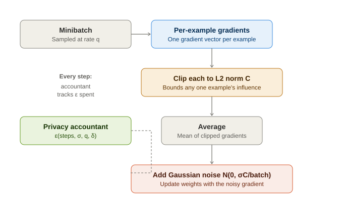
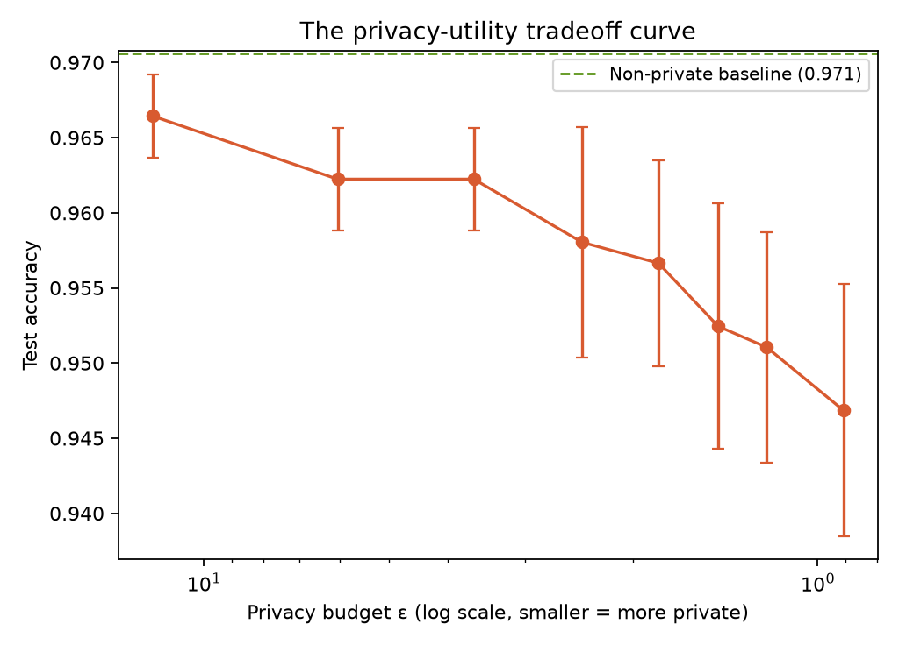
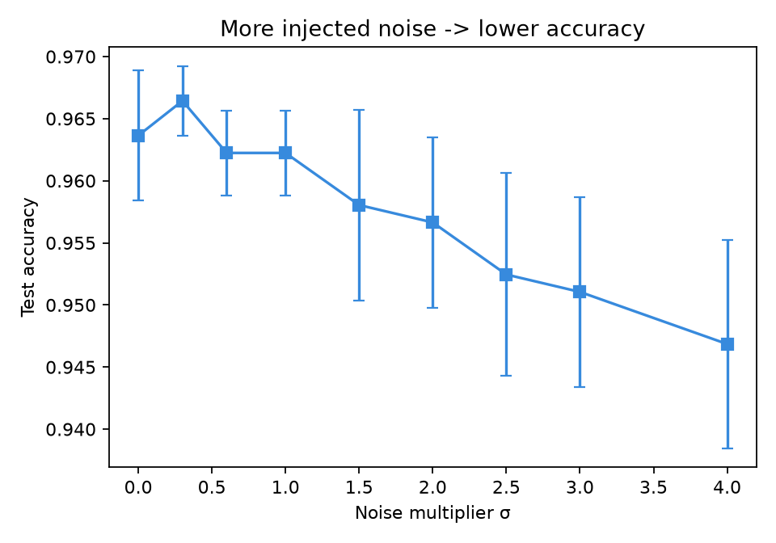
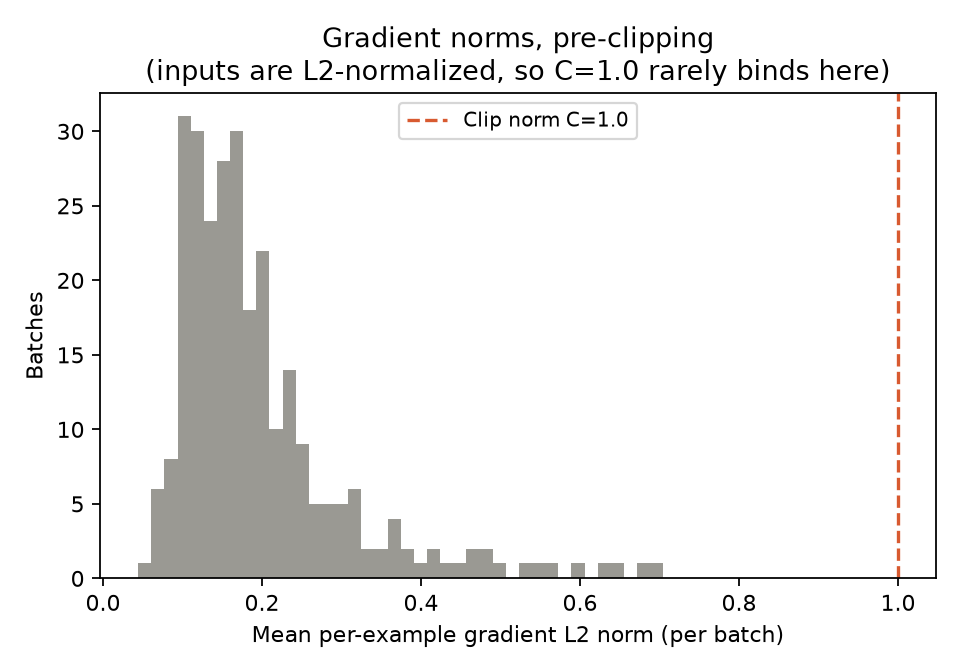

# DPML — DP-SGD from scratch, with the real privacy-utility tradeoff


A from-scratch implementation of **DP-SGD** (Abadi et al., 2016,
"Deep Learning with Differential Privacy") — per-example gradient
clipping, calibrated Gaussian noise, and a privacy accountant that turns
noise into an actual epsilon — built to show the tradeoff DP-ML papers
always report and most demos never actually measure: **how much accuracy
do you give up, in exchange for how much formal privacy?**



## Why per-example clipping, not just noise

An ordinary minibatch gradient is already an average — you can't bound
how much a single training example influenced it after the fact. DP-SGD
computes **every example's own gradient**, clips each one's L2 norm to a
fixed bound C *before* averaging, and only then adds noise. That clip is
what makes the sensitivity of the averaged gradient provably bounded, which
is what makes the Gaussian-mechanism privacy guarantee valid in the first
place — noise without per-example clipping isn't differential privacy,
it's just noise.

## Quickstart

```bash
python -m venv .venv && source .venv/bin/activate
pip install -e ".[dev]"
python experiments/run_experiment.py   # ~15s — regenerates everything below
pytest -q                              # 7 tests
```

```python
from dpml.data import load_dp_dataset
from dpml.dp_sgd import DPLogisticRegression
from dpml.accounting import compute_epsilon

data = load_dp_dataset()
model = DPLogisticRegression(n_features=data.X_train.shape[1])
model.fit(data.X_train, data.y_train, epochs=20, clip_norm=1.0, noise_multiplier=1.0)

epsilon = compute_epsilon(steps=280, noise_multiplier=1.0, sampling_rate=0.075, delta=1e-4)
print(epsilon, model.accuracy(data.X_test, data.y_test))
```

## Results (real numbers from the committed experiment, 5 seeds per point)

Dataset: Breast Cancer Wisconsin (Diagnostic) — 569 patient records, 30
features, binary diagnosis. Patient-level medical data is exactly what
differential privacy exists to protect training on. 20 epochs, batch
size 32, clip norm C=1.0, δ=1/(10·n).

| Noise multiplier σ | Privacy budget ε | Test accuracy |
|---|---|---|
| 0 (clipped, no noise) | ∞ (not private) | 96.4% ± 0.5 |
| 0.3 | 12.1 | 96.6% ± 0.3 |
| 0.6 | 6.1 | 96.2% ± 0.3 |
| 1.0 | 3.6 | 96.2% ± 0.3 |
| 1.5 | 2.4 | 95.8% ± 0.8 |
| 2.0 | 1.8 | 95.7% ± 0.7 |
| 2.5 | 1.5 | 95.2% ± 0.8 |
| 3.0 | 1.2 | 95.1% ± 0.8 |
| 4.0 | 0.9 | 94.7% ± 0.8 |
| **True non-private baseline** (no clipping, no noise) | — | **97.1% ± 0.3** |

**The real tradeoff, in one line:** going from no privacy guarantee to a
*strong* one (ε≈0.9, a tight budget by most standards) costs about **2.4
points of accuracy** (97.1% → 94.7%) on this task — and the degradation is
smooth and monotonic, not a cliff, which is itself useful to know when
picking an operating point.



Two supporting diagnostics: accuracy as a direct function of the noise
multiplier you actually set (not everyone wants to think in epsilon), and
the raw per-example gradient-norm distribution that clipping acts on —
here mostly *below* the clip threshold, since inputs were L2-normalized
to norm 1 beforehand, a reminder that an overly generous clip norm adds
noise variance without buying any extra privacy.

| Accuracy vs. noise | Gradient norms (why clipping exists) |
|---|---|
|  |  |

## Repository layout

```
src/dpml/
├── data.py         Breast Cancer Wisconsin dataset, L2-normalized per DP-SGD convention
├── dp_sgd.py        DP-SGD logistic regression: per-example clipping + Gaussian noise
└── accounting.py    epsilon computation (Abadi et al. 2016 simplified bound)
experiments/run_experiment.py   regenerates every number and plot above
tests/                          7 tests — accounting math, clipping behavior, accuracy degradation
```

## Limitations

- **The privacy accountant is a simplified, illustrative bound**, not the
  tight numerical moments-accountant / RDP accountant that production
  libraries (Opacus, TensorFlow Privacy) use — it gets the *scaling*
  right (ε grows with steps, shrinks with noise and batch-sampling rate)
  but the exact constant is looser than a real deployment should rely on.
  Any real DP-ML system should use Opacus or TF-Privacy's accountant, not
  this one, for a number that goes in a compliance document.
- Logistic regression only — DP-SGD for deep networks needs
  per-example gradients through every layer (typically via vectorized
  JAX/PyTorch autodiff, not a hand-written backward pass), which is a
  substantial engineering step beyond what's shown here.
- A single dataset and a single clip norm are studied. The clip norm
  itself is a tunable hyperparameter with its own tradeoff (too small
  discards signal, too large admits more noise than necessary) that a
  production pipeline would sweep.

## License

[MIT](LICENSE)

## Author

**Thakur Ajay Kumar** — [Portfolio](https://trajay450.github.io/ajaytr/) · [GitHub](https://github.com/trajay450) · [LinkedIn](https://www.linkedin.com/in/ajay-kumar-thakur-aa7b96444/)
